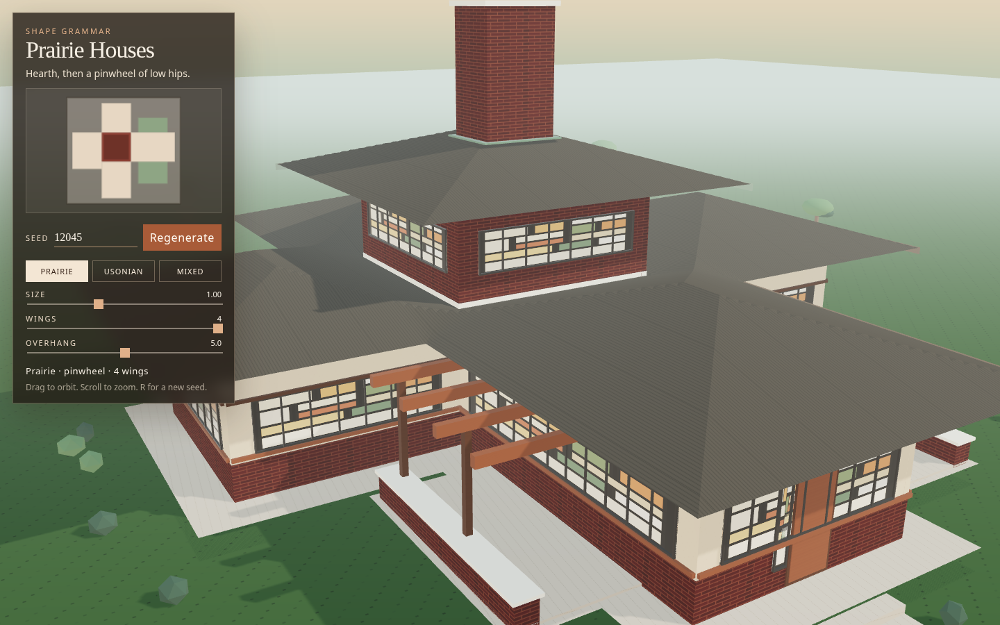

# Prairie Houses

A seedable Frank Lloyd Wright house generator. Prairie and Usonian plans are grown from a grammar — a hearth, then wings — and drawn with Three.js.

Open the app, orbit the house, and change the seed. The same seed and sliders always rebuild the same house. The seed, style, size, wing count, and overhang are written to the query string (`?seed=12045&style=prairie&size=1&wings=4&overhang=5`).



## Run

```bash
npm install
npm run dev
```

Other scripts:

- `npm test` — grammar and determinism tests
- `npm run typecheck`
- `npm run build` — typecheck, static site in `dist/`, and refresh the committed Pages files `index.html` and `app/`
- `npm run preview`

## Generation rules

The generator is a shape grammar on a **2 × 4 ft module** (the Usonian grid). Wing widths and lengths are multiples of 4 ft. The hearth is centered on the origin. A mulberry32 RNG is seeded with the integer in the URL, and `Math.random` is not used while a plan is built, so a seed is a pure function of the parameters.

**Start.** Place a square masonry hearth. Prairie hearths are 16 ft and carry a second-story pavilion. Usonian hearths are 12 ft and stay one story. Mixed style resolves to one of the two from the first random draw.

**Plan type** is a production of the wing-count slider and the style, not a scatter of boxes:

| Wings | Production |
| --- | --- |
| 2 | **L**, rotated. The two wings meet at a shared corner of the hearth. |
| 3 | **T**. One cardinal side is omitted. The crossbar is the longer living wing. |
| 4 | **Pinwheel** or **cruciform**. Prairie prefers the pinwheel (about 3 in 4). Usonian prefers the cruciform. |

**Wings.** Each wing is extruded from a hearth face.

- The first wing is the living wing and is longer. Later wings are chambers. Length is `round(base × size)` modules, clamped to 3–10 modules (12–40 ft).
- Width is 12, 16, or 20 ft on the module, narrowed to the hearth face when a wing has neighbors on both sides (the stem of a T, or every arm of a cruciform).
- **Pinwheel.** Each wing is shifted the same rotational sense: flush to one end of the hearth face, with any extra width growing the other way. Wide wings pass the corner but stay in their own outward half-plane, so they meet the hearth along a real edge and do not overlap.
- **L and T.** A wing with one neighbor is flush against that neighbor and grows into the open side. A wing with two neighbors is centered.

**Carport.** Usonian plans add a carport on the far end of the living wing, three to six modules long, open on the sides, under the same flat roof. Prairie plans do not.

**Terrace and planter.** A terrace is placed on an open long side of the living wing, 8 or 12 ft deep. A low brick planter with a stone coping runs along its outer edge. If the first side collides with another volume, the grammar tries the other long side.

**Roofs.** Every enclosed volume gets a roof record.

- Free sides cantilever by the overhang slider (2–8 ft). The side that dies into a parent has overhang 0, so the eave is flush there and the volume is still covered.
- The Prairie pavilion roof keeps the full overhang on every side and sails out over the wings. Wing hips are lower.
- Prairie roofs are hips at rise/run 0.3. The mesh is one distance field over the union of the wing eaves, so hips and valleys meet instead of intersecting as separate boxes. The pavilion is its own higher hip.
- Usonian roofs are a single flat slab over the union of every eave, including the carport. The underside is a light soffit; the edge is a dark fascia.

**Windows.** On every exposed facade longer than 8 ft, inset 1.5 ft from the corners:

- Prairie wings get an art-glass ribbon (sill 3 ft, head about 6.5 ft). The upper pavilion gets a second ribbon.
- Usonian living wings get a tall glass band plus a clerestory tucked under the eave. Other wings get a shorter ribbon and the same clerestory.
- Mullions are on a **2 ft** rhythm (half a module), with the bays centered in the band. A string course runs the full facade at the sill and the head.

**Plinth.** The house sits on a stone base: 1.55 ft for Prairie, 0.45 ft for Usonian. Footprints are skirted (3 ft Prairie, 1.5 ft Usonian) and unioned. Steps drop from the entry edge to the lawn.

## Project layout

| Module | Role |
| --- | --- |
| `src/rng.ts` | Seeded mulberry32 |
| `src/params.ts` | Sliders, clamps, `?seed=` query string |
| `src/grammar/plan.ts` | The shape grammar |
| `src/grammar/invariants.ts` | Hearth, connectivity, overlap, roof coverage, overhang bounds |
| `src/geometry/union.ts` | Orthogonal rectangle union |
| `src/geometry/roofs.ts` | Flat slabs and hip distance fields |
| `src/geometry/windows.ts` | Ribbons, clerestories, mullions |
| `src/geometry/build.ts` | Massing, materials, chimney, carport, pergola |
| `src/materials.ts` | Stucco, Roman brick, board-and-batten, oak, roofs |
| `src/scene.ts` | Sun, shadows, orbit camera |
| `src/landscape.ts` | Lawn, trees, carport drive |
| `src/ui.ts` | Seed, regenerate, style, sliders, plan diagram |

## Tests

`npm test` checks:

- The same seed replays the same RNG sequence and the same plan, without calling `Math.random`.
- Query parameters round-trip and clamp.
- Rectangle unions, including an L and a hole.
- Across Prairie, Usonian, and mixed, and across size, wing count, and overhang: the hearth is present and contains the origin, every wing shares a face with the hearth, the carport joins its wing, volumes do not overlap, a roof covers every volume, and overhangs stay inside `0 … slider`.
- A hand-built overlap and a roof that is too small fail those checks.

## Deploy

GitHub Pages publishes the `main` branch root (Deploy from a branch, folder `/`). `index.html` in the repository root is the built page. It loads the committed bundle in `app/assets/` with relative `./` paths, so `https://richardanaya.github.io/wright-house-generator/` resolves scripts and styles without a custom base. `.nojekyll` keeps Pages from running Jekyll on that bundle.

`index.dev.html` is the Vite entry (`/src/main.ts`). `npm run dev` serves it at `/`. `npm run build` typechecks, builds with `base: './'`, and rewrites `index.html` plus `app/`. Commit those files with the source change. CI fails when the committed bundle does not match a fresh build.

`.github/workflows/ci.yml` runs typecheck, tests, the production build, and that freshness check.

## Limits

These are massing studies, not measured drawings of a particular Wright house. Walls are shells with applied window bands rather than cut openings. The hip field is a half-foot grid, so ridges are a little softer than a straight skeleton. Interiors, furniture, and true art-glass designs are only suggested. Trees and shrubs are simple masses placed outside the plinth.
